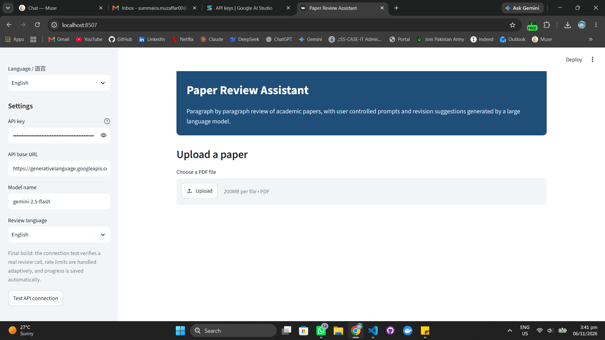
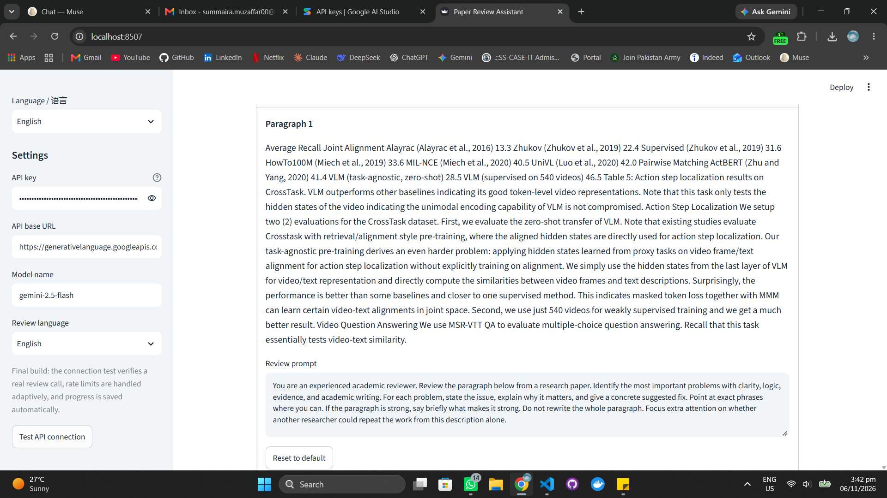
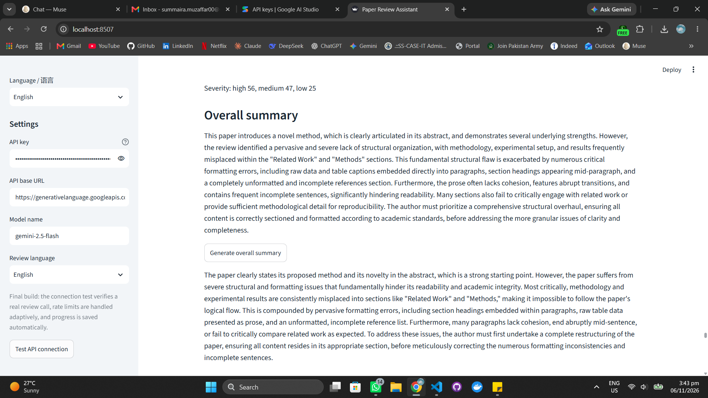

# Paper Review Assistant

An LLM based tool that reviews academic papers automatically, paragraph by paragraph.

Upload a paper as a PDF. The tool extracts the text, splits it into sections and paragraphs, and reviews every paragraph with a large language model. Each review returns the issues found (with severity, explanation, and a concrete suggested fix) plus the paragraph's strengths. Every paragraph has its own editable prompt, all results combine into one final report with an overall summary, and the report downloads as a DOCX file.

中文简介:本工具利用大语言模型逐段评审学术论文。用户上传 PDF 后,系统会提取全文,按章节和段落进行划分,并为每个段落生成结构化的评审意见,包括问题、严重程度、说明和修改建议。用户可以为每个段落自定义评审提示词,并可选择英文或中文作为评审语言。最终报告可以导出为 DOCX 文件。

## Why this project exists

Built as an assessment task for Professor Tao Huanjie, School of Computer Science, Northwestern Polytechnical University, Xi'an: an LLM based paper review tool that analyses a full paper, identifies problems, and generates revision suggestions.

The task has two hard requirements:

1. **A software interface.** A Streamlit web application with a settings sidebar and a guided flow from upload to report.
2. **User prompts for each paragraph.** Every paragraph carries its own editable prompt, prefilled with a section aware default and stored under its own key, so editing one paragraph never affects another. A reset button restores the default. This is covered by automated tests at the module level, in the interface, and at the model request level.

## Features

- **Extraction and splitting:** PDF text extraction with PyMuPDF (corrupt files and PDFs with no text are reported clearly), then rule based splitting into sections and paragraphs, with long blocks from two column papers chunked on sentence boundaries
- **Any OpenAI compatible API:** the user enters their own key, base URL, and model in the sidebar (DeepSeek works out of the box). No key is ever stored in the code or the repo
- **Structured results:** per paragraph strengths, and issues with severity, explanation, and suggested fix
- **Bilingual:** English interface with a Chinese toggle for all labels, and review output in English or Chinese
- **Final report:** totals, severity counts, strengths, issues grouped by section, an overall summary from a second model pass over a compact digest of the findings, and DOCX export
- **Fast on free tiers:** paragraphs are reviewed in small batches (up to 5 paragraphs, 8,000 characters per call, parallel waves of 3), so a 38 paragraph paper needs about 10 calls instead of 38. Any paragraph missing from a batch answer is reviewed again on its own
- **Built for rate limits:** a refused batch is retried once, then split into smaller batches down to single paragraphs; if refusals continue, the rest is saved for later. The connection test ends with one tiny real review call, so a spent quota fails once, before a run, with a clear explanation. Settings from different providers mixed together are blocked before any call, and every error is explained in plain language
- **Nothing is lost:** results are saved to disk after every paragraph (never the API key), so a closed tab or a sleeping laptop cannot wipe a run. Re-uploading the same paper restores its finished paragraphs, and Run review again completes only what is missing. One failed call never discards the rest of a review

## Screenshots

The app as it opens, with the settings sidebar:



The paper structure, with a paragraph and its editable prompt:



Review results and the final report:



## How it works

```
PDF upload
  -> text extraction, page by page (src/pdf_extract.py)
  -> section and paragraph splitting (src/segmentation.py)
  -> one prompt per paragraph, defaults plus user edits (src/prompts.py)
  -> batched model calls, each paragraph under its own id with its own prompt,
     structured JSON answer (src/llm_client.py)
  -> aggregation, overall summary, DOCX report (src/report.py)
Interface: app.py (Streamlit). Interface labels in English and Chinese: src/i18n.py.
```

Each stage is a small module with one job. BUILD_LOG.md records every build step, decision, and test result.

## How to run

```
pip install -r requirements.txt
streamlit run app.py
```

Then, in the page that opens:

1. Enter your API key, base URL, and model name in the sidebar. The three values must come from the same provider.
2. Press **Test API connection** to confirm the key and model before a full run.
3. Choose the review language, upload a paper as a PDF, and edit any paragraph's prompt if you want a different focus there.
4. Press **Run review**, then generate the overall summary and download the DOCX report.

## Project structure

```
app.py                  Streamlit interface
src/                    pdf_extract, segmentation, prompts, llm_client,
                        report, i18n (one module per job)
tests/                  Automated tests for every stage, plus a real
                        document pipeline runner
BUILD_LOG.md            Step by step build record with test results
KNOW_YOUR_PROJECT.md    Plain language guide to explaining the project
TEST_REPORT.md          Full testing account, including the verified live run
INTERFACE_DECISION.md   Why Streamlit, with the alternatives checked
LANGUAGE_PLAN.md        Why English main with a Chinese toggle
```

## Testing

45 automated tests across 6 test files cover extraction, splitting, per paragraph prompt isolation (including proof that a custom prompt reaches the model for its own paragraph only), structured answer parsing, batched reviewing with fallback, failure isolation, settings validation and the connection check with its real test call, the rate limit policy (retry, adaptive splitting, saved for later, circuit breaker), resumable runs, progress saving and restoring, plain language errors, aggregation, the size bounded summary digest, and DOCX read back. The full pipeline was also run on real papers, and a complete live run with a real API key was verified end to end (see TEST_REPORT.md, Addendum 14).

```
.venv/bin/python tests/test_pdf_extract.py
.venv/bin/python tests/test_segmentation.py
.venv/bin/python tests/test_prompts.py
.venv/bin/python tests/test_llm_client.py
.venv/bin/python tests/test_report.py
.venv/bin/python tests/test_progress_store.py
```

## Known limitations

- Scanned, image only PDFs contain no extractable text. The tool reports this clearly instead of inventing a review. OCR is out of scope.
- Figures and graphs themselves are not analysed, so the tool cannot judge whether a chart supports the claim made about it. Captions and table text in the text layer are reviewed as ordinary text. Analysing figure images with a vision language model is future work.
- Section detection is rule based and tuned for research papers. Figure and table labels can occasionally be mistaken for a heading, and documents that are not papers split less precisely, though they still complete the pipeline.
- Review quality depends on the model and the prompts chosen. The tool structures model feedback; it does not guarantee the feedback is correct, and a human should read the report before acting on it.

## Author

Summaira Muzaffar, BS Computer Science, Sir Syed CASE Institute of Technology, Pakistan. Research Assistant at CARE (dotAI department).

## License

MIT. See LICENSE.
